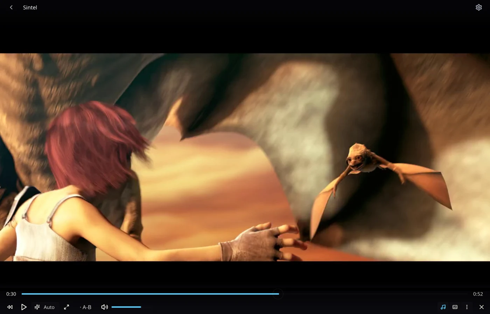
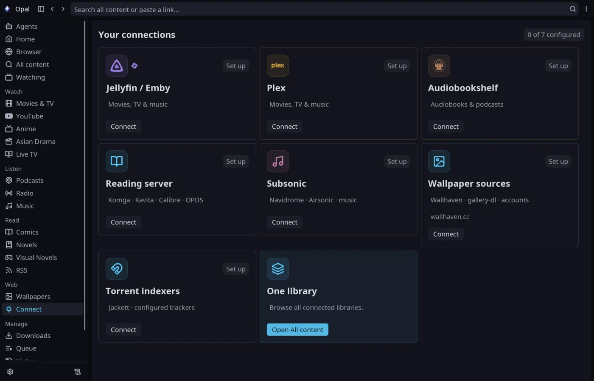
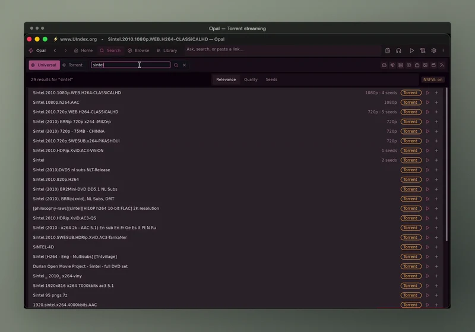
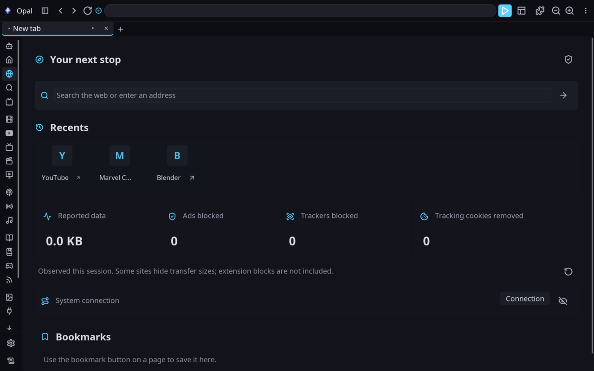

<div align="center">


# Opal

### The open-source Netflix, Plex & Jellyfin alternative — in one native binary.

Web browser · Torrent streamer · Movie & TV hub · Anime player · YouTube client · Live TV<br>
Manga & comic reader · Jellyfin & Plex client · Casting · Watch parties · Subtitles · Translation<br>
Downloads · RSS · Plugins · Local AI · Voice control · Agent automation

[](https://github.com/debpalash/Opal/releases/latest)
[](https://github.com/debpalash/Opal/releases)
[](LICENSE)
[](https://github.com/debpalash/Opal/actions/workflows/ci.yml)

**macOS · Linux · Windows · iOS · Android (planned)**

**[Download](https://github.com/debpalash/Opal/releases/latest)** · [Website](https://opal.palash.dev) · [Features](#everything-in-one-app) · [Install](#get-it) · [What’s new](CHANGELOG.md)

</div>



<sub>Native UI preview. Sintel © Blender Foundation, [CC BY 3.0](https://creativecommons.org/licenses/by/3.0/). [Credits](assets/readme/CREDITS.md).</sub>

## Why Opal

Streaming is split across subscriptions, servers, and a dozen apps. Opal puts it in
**one native app**: no server to run, no account to create, no subscription, no telemetry.

| | **Opal** | Netflix | Plex | Jellyfin |
| --- | :---: | :---: | :---: | :---: |
| Free & open source | ✅ | ❌ | ❌ | ✅ |
| No server required | ✅ | ✅ | ❌ | ❌ |
| No account or subscription | ✅ | ❌ | ❌ | ✅ |
| Your own files and sources | ✅ | ❌ | ✅ | ✅ |
| Torrent streaming | ✅ | ❌ | ❌ | ❌ |
| YouTube, live TV, manga in the same app | ✅ | ❌ | ❌ | ❌ |
| Local AI & agent automation | ✅ | ❌ | ❌ | ❌ |
| Plays your Plex & Jellyfin libraries | ✅ | — | ✅ | ✅ |

<sub>Opal is a player and source hub. It ships no catalog and no Netflix titles; it connects to Plex and Jellyfin servers rather than replacing them.</sub>

## Everything in one app

| | |
| --- | --- |
| 🎬 **Movie & TV hub** | Netflix-style discovery, details, watchlists, and resume, all from your own files and sources. |
| 🧲 **Torrent streamer** | Stream a magnet while it downloads, with queues, transfers, and an optional in-memory buffer. |
| 🌸 **Anime player** | Anime sources, airing schedules, and subtitle tracks. |
| ▶️ **YouTube client** | Search and play, with SponsorBlock and browser handoff. |
| 📺 **Live TV** | IPTV and M3U channels from the sources you enable. |
| 📚 **Manga & comics** | A built-in reader with Suwayomi and Mihon/Tachiyomi extensions. |
| 🗂️ **Jellyfin & Plex client** | Browse and play your existing server libraries. |
| 🌐 **Web browser** | Tabs, extensions, and send-to-player (macOS). |
| 📡 **Casting & watch parties** | Cast to another screen or watch in sync with friends. |
| 💬 **Subtitles & translation** | Pick tracks, fetch subtitles, and translate them on the fly. |
| ⬇️ **Downloads & RSS** | Download queues, plus RSS feeds for torrents and podcasts. |
| 🧩 **Plugins** | Install only the sources you want; every source starts disabled. |
| 🧠 **Local AI & voice** | Optional on-device recommendations, voice control, and OCR. |
| 🤖 **Agent automation** | 100+ MCP tools so Claude Code, Codex, or any MCP client can search, play, queue, and download. |

[Source coverage](docs/browse-sources.md) · [Roadmap](ROADMAP.md)

## See it

<table>
<tr>
<td width="50%"></td>
<td width="50%"></td>
</tr>
<tr>
<td align="center"><sub><b>Native player.</b> Big Buck Bunny © 2008 Blender Foundation, CC BY 3.0.</sub></td>
<td align="center"><sub><b>Connect.</b> Plex, Jellyfin, indexers, and more.</sub></td>
</tr>
<tr>
<td width="50%"><a href="assets/media/stream-a-torrent.mp4"></a></td>
<td width="50%"></td>
</tr>
<tr>
<td align="center"><sub><b>Torrent streaming</b> (<a href="assets/media/stream-a-torrent.mp4">watch</a>). Sintel © Blender Foundation, CC BY 3.0.</sub></td>
<td align="center"><sub><b>Built-in browser</b> with tabs and extensions.</sub></td>
</tr>
</table>

<a id="get-it"></a>

## Get Opal

One command detects your platform and verifies the download:

```sh
curl -fsSL https://raw.githubusercontent.com/debpalash/Opal/main/scripts/install.sh | sh
```

Or grab a package from [Releases](https://github.com/debpalash/Opal/releases/latest):

| Platform | Install |
| --- | --- |
| **macOS** (Apple silicon) | `.dmg`, or `brew install debpalash/tap/opal` |
| **Linux** | AppImage, `.deb`, `.rpm`, or AUR `opal-media-player-bin` |
| **Windows** (alpha) | `.msi` or portable `.zip` |
| **iOS** (preview) | Sideload the `.ipa`, or [build for your device](docs/ios.md) |
| **Android** | Planned |

<details>
<summary><b>Install notes</b></summary>

- **macOS:** if an unnotarized DMG shows “damaged,” run `sudo xattr -cr /Applications/Opal.app`. Intel Macs need a source build with `HOMEBREW_PREFIX=/usr/local`.
- **Linux:** standard builds need glibc 2.38+. Ubuntu 20.04/22.04, Debian 12, and Mint 21 should use `_compat_amd64.deb` (glibc 2.31+); the installer picks it for you. [Compatibility details](packaging/linux-compat/README.md).
- **Windows:** expect SmartScreen prompts and rough edges. [Report an issue](https://github.com/debpalash/Opal/issues).
- **Updates:** Opal checks for updates and installs them in place on macOS. Package-managed installs update through their package manager.

</details>

**First launch:** browse **Movies & TV** right away, or add sources in **Settings → General → Install source plugins**.

## Control it from anywhere

- **From your phone:** enable **Settings → Web UI**, set **Network** to **LAN**, and scan the QR code. [Phone guide](docs/web-companion.md)
- **From your browser:** the [Opal Connect](extension/README.md) extension for Chrome, Edge, and Firefox sends videos to Opal and controls playback.
- **From an AI agent:** turn on **Settings → Agent Access** and connect `opal-mcp` to Claude Code, Codex, Gemini CLI, or any MCP client. Destructive tools are off until you opt in. [Agent guide](docs/mcp.md)

<a id="building-from-source"></a>

## Build from source

**Zig 0.17 · dvui · mpv**: one native binary with no Electron and no web runtime.

```sh
brew install mpv sqlite sdl2 libtorrent-rasterbar webp
git clone https://github.com/debpalash/Opal.git && cd Opal
zig build run
```

<details>
<summary><b>Linux and development</b></summary>

**Linux / Wayland:** run `./scripts/install-deps.sh`, then `make run`. Minimums: libmpv **0.34** (0.38+ recommended), libtorrent-rasterbar 2.0, SDL 2.0.22.

| Command | Purpose |
| --- | --- |
| `./dev.sh` | Hot reload |
| `just release` | ReleaseFast build |
| `zig build test` | Unit tests |
| `just test-all` | Full feature suite |

</details>

[Architecture](docs/architecture.md) · [Contributing](.github/CONTRIBUTING.md)

## Support

If Opal replaces a subscription for you, [star the repo](https://github.com/debpalash/Opal/stargazers) to help others find it.

[Report a bug](.github/SUPPORT.md) · [Discussions](https://github.com/debpalash/Opal/discussions) · [Ko-fi](https://ko-fi.com/debpalash) · [PayPal](https://paypal.me/palashCoder)

---

<sub>**GPL-3.0.** [License](LICENSE) · [Notices](docs/NOTICE.md). Opal plays sources you configure; it hosts no media and provides no Netflix titles. Not affiliated with Netflix, Plex, or Jellyfin. Only access content you have the right to use. BitTorrent shares your IP with peers. [Content policy](docs/CONTENT_POLICY.md) · [Privacy](docs/PRIVACY.md) · [DMCA](docs/DMCA.md)</sub>
